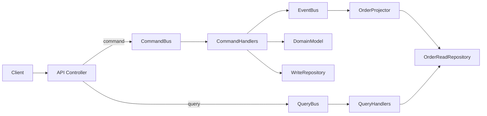
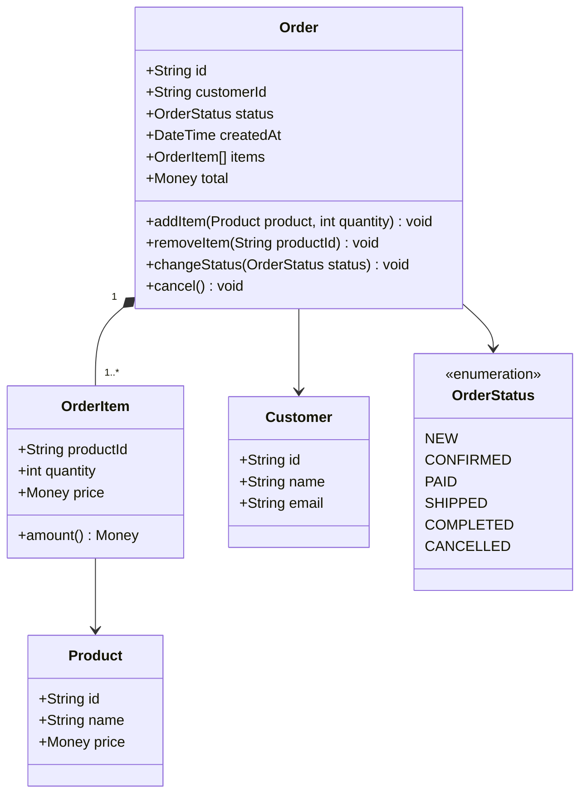

# Лабораторная работа №5 — CQRS (Вариант 19)

**Студенты:** Стародубцев Арсений, Гушаил Назар, группа ИСП-30, 31

**Тема:** система управления заказами на архитектуре CQRS

## Тема и цель

Цель работы — спроектировать приложение для системы управления заказами, в
котором операции изменения данных отделены от операций чтения. Результат —
UML-модель и проектное описание: команды, запросы, обработчики, модели записи
и чтения. Программная реализация в рамках работы не выполняется.

## Задание

Вариант 19. Пользователь создаёт заказ и добавляет в него товары. Заказ
содержит клиента, позиции, стоимость, дату создания и статус. Изменение
состояния выполняется только командами, получение информации — только
запросами: команды не читают данные, запросы не меняют состояние. Требуется
спроектировать 5 команд, 5 запросов, обработчик на каждую операцию и
отдельные модели чтения и записи.

## Архитектура CQRS

**Write side.** Команда попадает в `CommandBus`, находит свой обработчик,
который загружает агрегат `Order`, вызывает его методы (там проверяются
инварианты), сохраняет агрегат через write-репозиторий и публикует доменные
события.

**Read side.** Запрос попадает в `QueryBus`, обработчик читает готовую
проекцию `OrderView` из read-репозитория и возвращает DTO. Домен при этом не
загружается.

**Синхронизация.** `OrderProjector` подписан на события домена и обновляет
read-модель: `OrderCreated`, `OrderItemAdded`, `OrderItemRemoved`,
`OrderStatusChanged`, `OrderCancelled`.

## Диаграмма компонентов



## Диаграмма классов



## Доменная модель

- **Order** — агрегат заказа: позиции, статус, дата создания и итоговая стоимость.
- **OrderItem** — позиция заказа: товар, количество и зафиксированная цена.
- **Product** — товар каталога с актуальной ценой.
- **Customer** — покупатель: имя и контактный e-mail.
- **OrderStatus** — перечисление состояний заказа от `NEW` до `COMPLETED`/`CANCELLED`.

## Команды

| Команда | Обработчик | Назначение |
|---|---|---|
| `CreateOrderCommand` | `CreateOrderHandler` | создать заказ для клиента |
| `AddProductCommand` | `AddProductHandler` | добавить товар в заказ |
| `RemoveProductCommand` | `RemoveProductHandler` | удалить позицию из заказа |
| `ChangeOrderStatusCommand` | `ChangeOrderStatusHandler` | перевести заказ в другой статус |
| `CancelOrderCommand` | `CancelOrderHandler` | отменить заказ |

## Запросы

| Запрос | Обработчик | Что возвращает |
|---|---|---|
| `GetOrderQuery` | `GetOrderHandler` | `OrderView` по идентификатору |
| `GetOrdersQuery` | `GetOrdersHandler` | список `OrderView` |
| `GetOrdersByCustomerQuery` | `GetOrdersByCustomerHandler` | заказы клиента |
| `GetOrdersByStatusQuery` | `GetOrdersByStatusHandler` | заказы в заданном статусе |
| `GetOrderStatisticsQuery` | `GetOrderStatisticsHandler` | агрегаты: количество и сумма по статусам |

## Правило CQRS

Команда описывает намерение изменить состояние и не возвращает данные для
отображения. Запрос только читает подготовленную проекцию и не меняет
состояние. Поэтому обработчик команды не формирует DTO, а обработчик запроса
не обращается к write-репозиторию.

## Документация

- [docs/domain-model.md](docs/domain-model.md) — сущности, связи, инварианты
- [docs/architecture.md](docs/architecture.md) — слои CQRS и синхронизация
- [docs/cqrs-commands-queries.md](docs/cqrs-commands-queries.md) — команды, запросы, обработчики
- [docs/uml/class-diagram.md](docs/uml/class-diagram.md) — диаграмма классов
- [docs/uml/component-diagram.md](docs/uml/component-diagram.md) — диаграмма компонентов
- [docs/uml/sequence-create-order.md](docs/uml/sequence-create-order.md) — создание заказа
- [docs/uml/sequence-add-product.md](docs/uml/sequence-add-product.md) — добавление товара
- [docs/uml/sequence-get-orders-by-customer.md](docs/uml/sequence-get-orders-by-customer.md) — заказы клиента
- [docs/uml/sequence-cancel-order.md](docs/uml/sequence-cancel-order.md) — отмена заказа
- [docs/uml/order-state-machine.md](docs/uml/order-state-machine.md) — состояния заказа

## Git workflow

В репозитории две ветки: `main` — стабильная версия, `dev` — разработка.
Прямые коммиты в `main` запрещены.
Request из `dev` с merge-коммитом. Сообщения коммитов оформляются по схеме
Conventional Commits (`docs:`, `feat:`, `chore:`).

## Структура репозитория

```
lab5-cqrs/
├── README.md
├── .gitignore
└── docs/
    ├── architecture.md
    ├── domain-model.md
    ├── cqrs-commands-queries.md
    └── uml/
        ├── class-diagram.md
        ├── component-diagram.md
        ├── sequence-create-order.md
        ├── sequence-add-product.md
        ├── sequence-get-orders-by-customer.md
        ├── sequence-cancel-order.md
        └── order-state-machine.md
```
