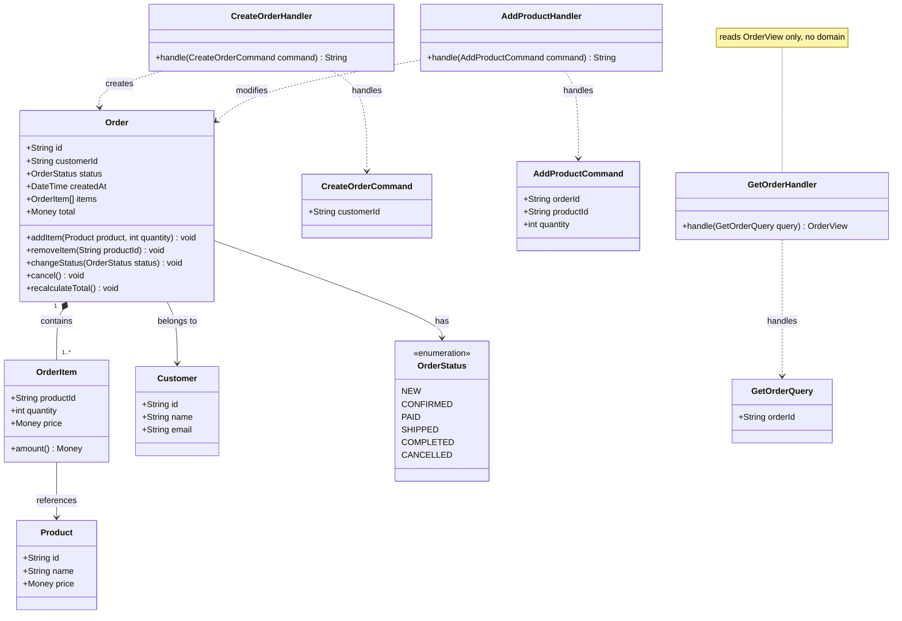

# Диаграмма классов

Диаграмма фиксирует границу агрегата: `Order` владеет позициями (композиция),
а `Product` и `Customer` — внешние сущности, на которые заказ ссылается по
идентификатору. Обработчики команд зависят от команды и агрегата, обработчик
запроса — только от запроса и read-модели `OrderView`, поэтому домен в
чтении не участвует.
