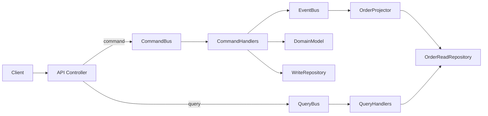

# Диаграмма компонентов

Схема показывает два независимых маршрута: команда идёт через `CommandBus` в
домен и write-репозиторий, запрос — через `QueryBus` сразу в
`OrderReadRepository`. Стороны связаны только шиной событий и проектором,
поэтому чтение не загружает агрегат, а запись не формирует DTO.
