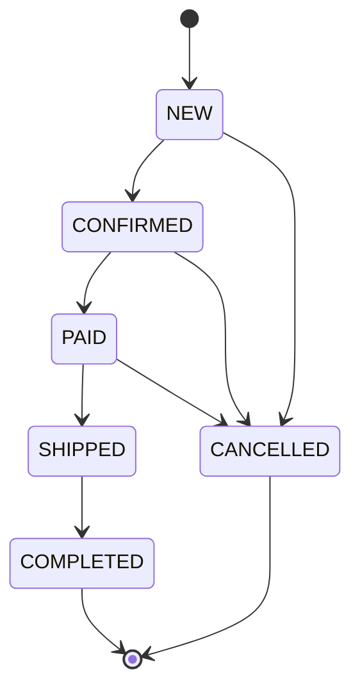

# Состояния заказа

| Из | В | Условие |
|---|---|---|
| `[*]` | `NEW` | `CreateOrderCommand` |
| `NEW` | `CONFIRMED` | `ChangeOrderStatusCommand`, заказ существует |
| `CONFIRMED` | `PAID` | `ChangeOrderStatusCommand`, оплата подтверждена |
| `PAID` | `SHIPPED` | `ChangeOrderStatusCommand`, заказ собран |
| `SHIPPED` | `COMPLETED` | `ChangeOrderStatusCommand`, доставка завершена |
| `NEW` | `CANCELLED` | `CancelOrderCommand` |
| `CONFIRMED` | `CANCELLED` | `CancelOrderCommand` |
| `PAID` | `CANCELLED` | `CancelOrderCommand` |
| `SHIPPED`, `COMPLETED` | — | отмена запрещена |

Диаграмма задаёт единственный допустимый порядок обработки заказа. Любой
другой переход отклоняется доменом: например, из `NEW` нельзя сразу в
`SHIPPED`, а из `SHIPPED` и `COMPLETED` нельзя отменить заказ.
