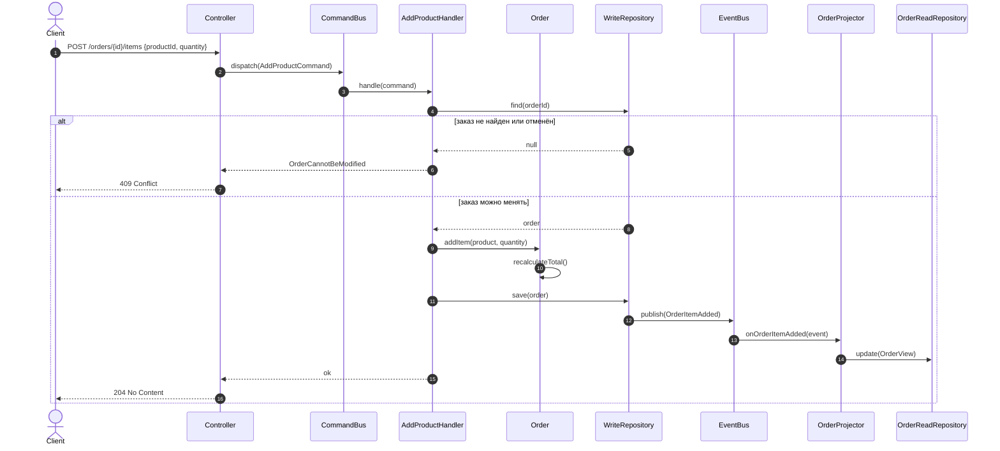

# Последовательность: добавление товара в заказ

Перед изменением обработчик проверяет, что заказ существует и не отменён, а
инварианты количества и цены проверяет сам агрегат в методе `addItem`. После
сохранения публикуется `OrderItemAdded`, и проектор пересчитывает `OrderView`.
