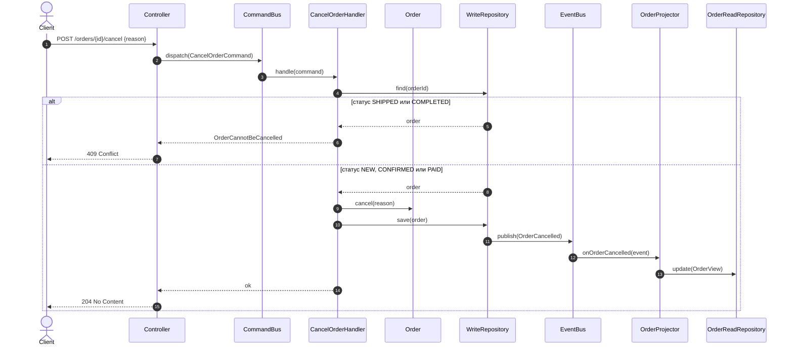

# Последовательность: отмена заказа

Отмена запрещена для отправленных и выполненных заказов — это проверяет и
обработчик, и сам агрегат. После сохранения публикуется `OrderCancelled`, а
проектор переводит `OrderView` в статус `CANCELLED`.
