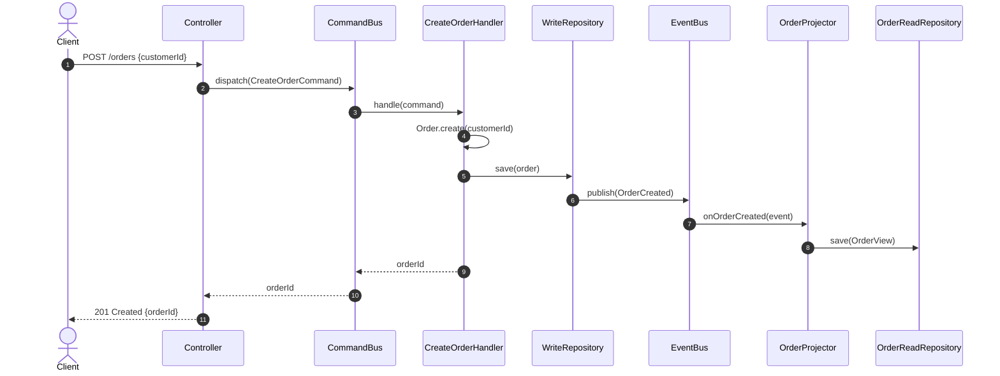

# Последовательность: создание заказа

Команда проходит путь «контроллер → шина → обработчик → репозиторий», после
сохранения публикуется `OrderCreated`. Проектор по событию создаёт строку
`OrderView`, поэтому чтение сразу видит новый заказ. Клиенту возвращается
только идентификатор, а не данные заказа.
