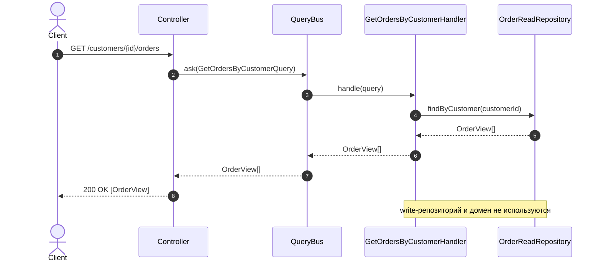

# Последовательность: заказы клиента (запрос)

В этом сценарии нет ни домена, ни write-репозитория: обработчик запроса
обращается только к `OrderReadRepository` и возвращает готовые `OrderView`.
Это и есть смысл разделения — чтение не зависит от модели записи и её
инвариантов.
